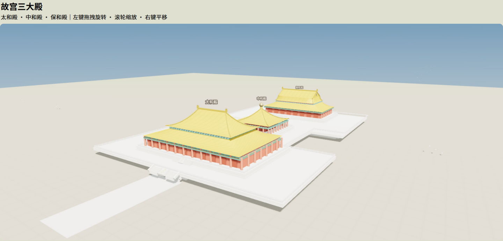
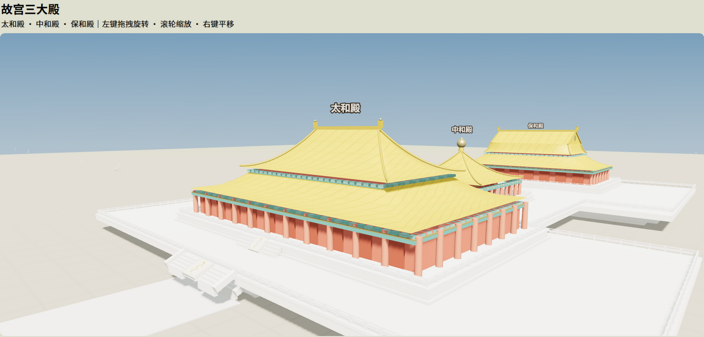
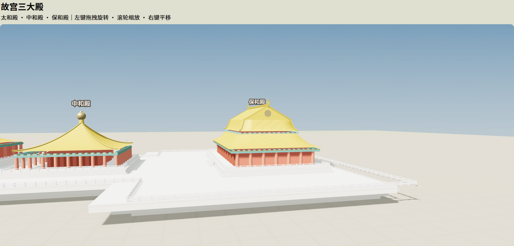
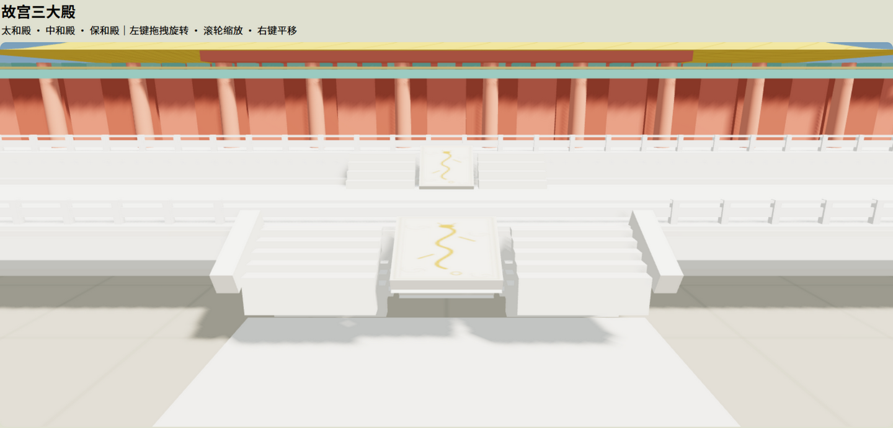
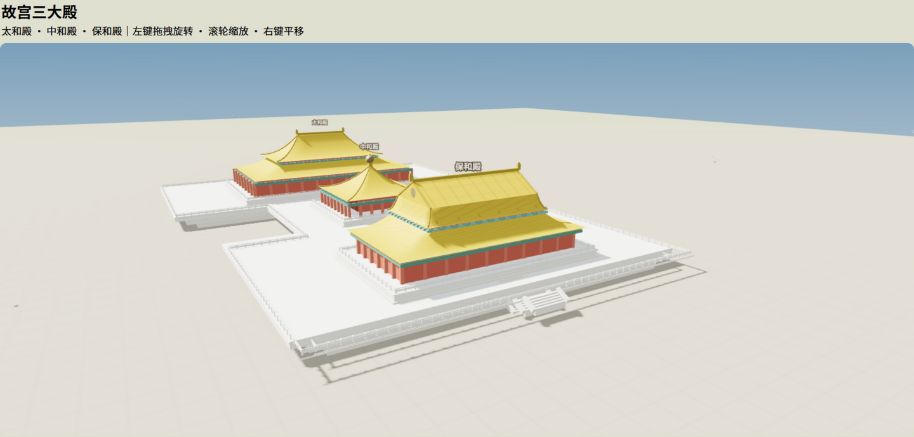

# playing · 故宫三大殿三维模型

使用 Three.js 在浏览器中交互式呈现北京故宫中轴线上的三大殿——**太和殿、中和殿、保和殿**，以及它们共同坐落的**三层汉白玉须弥座台基**。全部建模、贴图均在浏览器端程序化生成，无外部模型资源。

## 预览

| 总览 | 太和殿近景 |
| --- | --- |
|  |  |
| **保和殿歇山山花 · 中和殿攒尖宝顶** | **南面御路与三层踏跺** |
|  |  |
| **北立面与后阶** | |
|  | |

## 建筑形制

| 殿座 | 屋顶形制 | 模型要点 |
| --- | --- | --- |
| 太和殿 | 重檐庑殿顶 | 上檐四坡覆 + 下檐环坡，正脊两端鸱吻，四条戗脊缀檐角走兽 |
| 中和殿 | 单檐四角攒尖顶 | 方形平面，四脊汇聚于顶，上置鎏金宝珠 |
| 保和殿 | 重檐歇山顶 | 上檐前后坡接东西山花（饰金色团花）与博风板，下檐环坡 |

三殿共同配置：黄琉璃瓦（含瓦垄纹理）、朱红柱墙与格扇门、檐下青绿斗栱与金线额枋、汉白玉须弥座台基（望柱栏杆 + 排水螭首）、南面三层踏跺夹刻龙御路石、北面后阶。

## 交互

- **左键拖拽** — 环绕旋转（初始自动环绕展示，用户接管后停止）
- **滚轮** — 缩放
- **右键拖拽** — 平移
- 在 ZCode 内嵌环境中运行时，会记住你上次停留的视角

## 技术实现

- **Three.js r128（UMD）+ OrbitControls**：无构建步骤，两个 CDN `<script>` 即可运行
- **环面放样屋面几何**：矩形截面沿凹曲曲线（`y = H·s^p`）逐层收缩，生成庑殿 / 攒尖 / 歇山屋面，檐角按角部权重起翘；垂脊与戗脊由 CatmullRom 样条管线沿曲面爬行
- **瓦垄 UV**：屋面 u 坐标按环线周长弧长参数化并整圈取整，保证筒瓦垄跨面无缝闭合
- **InstancedMesh 批量渲染约 1900 个构件**：望柱、栏板、垂带、踏跺、双色斗栱、排水螭首
- **CanvasTexture 程序化贴图**：御路石龙纹（贝塞尔龙身 + 云纹）、天空渐变、广场地砖
- PCFSoft 软阴影 + ACESFilmic 色调映射，`prefers-reduced-motion` 下关闭自动环绕

## 本地运行

任选其一（Three.js 由 CDN 加载，首次打开需联网）：

```bash
# 方式一：直接用浏览器打开 index.html

# 方式二：本地起服务
python -m http.server 8000     # 打开 http://localhost:8000
npx serve .
```

需要支持 WebGL 的现代浏览器。

## 目录结构

```
playing/
├── index.html        # 三维模型单页（含全部建模代码）
└── screenshots/      # 渲染截图
```

## License

[MIT](LICENSE)
